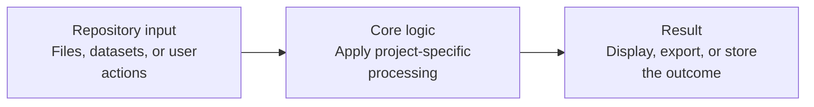

# PyGame

**Learning archive** · A learning repository for the Pygame toolkit and interactive Python game basics.

## Overview

A learning repository for the Pygame toolkit and interactive Python game basics.

## Technology Stack

- `Python`

## How the Repository Works

| Stage | Responsibility |
|---|---|
| **Repository input** | Files, datasets, or user actions |
| **Core logic** | Apply project-specific processing |
| **Result** | Display, export, or store the outcome |

## Concepts Covered

- Python fundamentals
- File or event handling
- Libraries
- Debugging
- Small application structure

## Repository Map

- `.gitignore`
- `intro`

## Recruiter Summary

This repository shows hands-on practice, iterative learning, and problem-solving across the technologies listed above. It is most useful as evidence of foundational growth and experimentation rather than as a production release.

---

Documentation is concise and project-focused; source code was not modified.
